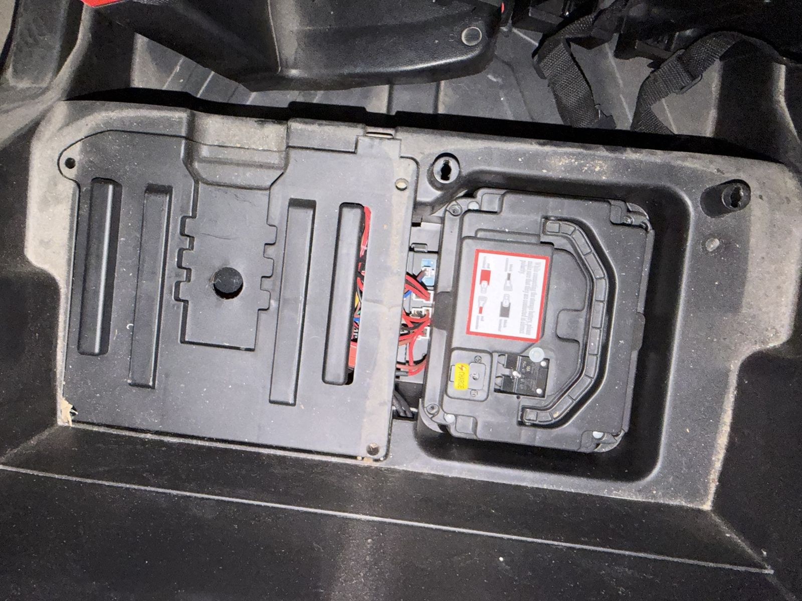
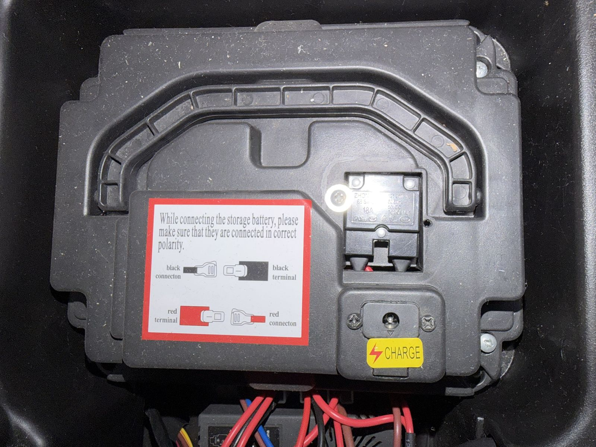
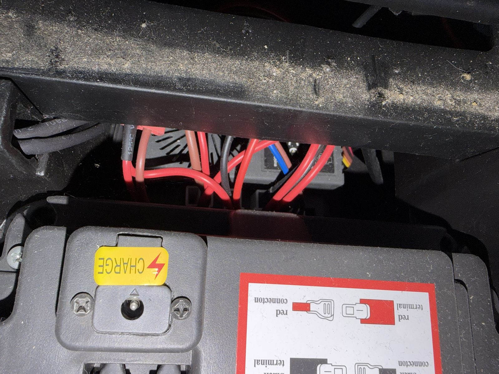
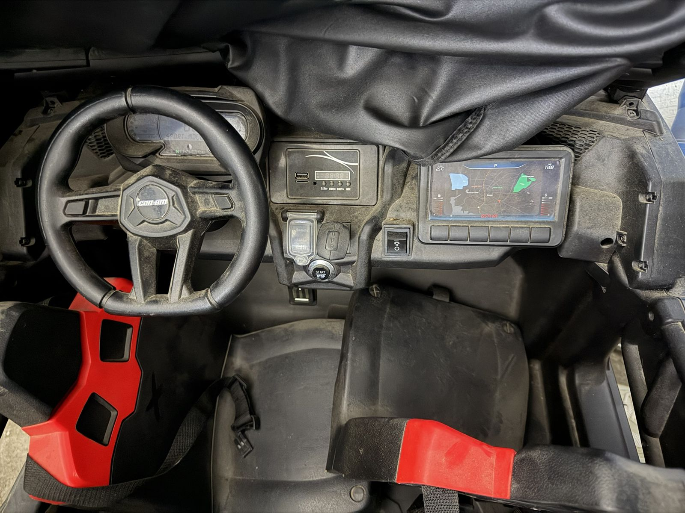

# The car

| Fact | Value | Source |
| --- | --- | --- |
| Model | Can-Am Maverick X3 24V Ride-On Buggy | kolbosima.co.il item 8419715; confirmed by Shai |
| Drive motors | 4, one per wheel | Confirmed by Shai |
| Steering | Electric steering motor; the child steers by hand in Kid mode | |
| Weight / size | 42 kg, 147 × 86 × 88 cm, two seats | Listing |
| Rider limit | about 35 kg | Listing |
| Stock top speed | 4.5 / 6 / 7.5 km/h by gear | Listing |
| State | 100 % factory original; nothing wired yet | |
| Battery protection | 18 A thermal overload breaker with a push-to-reset button, on the battery pack (rated 50 V DC) | Photo, 2 Nov 2026 |
| Charging | Round charge jack on top of the battery pack | Photo, 2 Nov 2026 |
| Power switch | START/STOP push button on the dash, no key | Photo, 2 Nov 2026 |
| Stock remote | Remote / Manual selector on the dash (the HY2005RX has a built-in 2.4 GHz receiver) | Photo, 2 Nov 2026 |

## What the stock car looks like (photos, 2 Nov 2026)

Photos in [photos/](photos/), with metadata removed. The car was not opened yet: the controller bay cover needs a screwdriver.

### Under the seat

Two compartments sit side by side under the seat:

- **Right: the battery pack**, a sealed black case with a carry handle, held in a moulded well by four screws. On top it has the round **CHARGE** jack, the **18 A breaker** and a sticker asking to connect red to red and black to black. The sticker shows insulated blade (spade) terminals, which is the usual fit on a sealed lead-acid battery inside, but this is a guess: the battery label (#13) is still needed.
- **Left: the controller bay**, under a moulded cover with four corner screws and a round hole in the middle (probably a wire pass-through). Through the gap at its edge you can see the stock controller box with cooling slots, a smaller box marked with a battery symbol, bundles of red and brown wires, one black and one blue wire, a thin red-orange-yellow signal lead, and several red insulated blade terminals.

The breaker label reads `18A`, `125/250VAC 50/60Hz`, `50VDC`, `TC2/OL1/U1`, with UL, CSA and RoHS marks. It is the common push-button overload protector of household tools: it trips on heat, so it lets short current peaks through and trips on a sustained overload.

### Dashboard

From left to right:

- **Instrument cluster** behind the wheel, an LCD showing "SPORT MODE", a gear letter and a speed or battery bar. It is probably driven by the stock controller.
- **Speaker grilles:** a hex mesh on each end of the dash, left of the cluster and right of the screen. These are likely the stock speakers.
- **MP3 panel:** USB-A, micro SD slot, a small round jack (AUX or mic), a 4-digit LED display, and four buttons (heart/V-, STORY, MUSIC/V+, MODE).
- **Remote / Manual selector** under a clear flip cover, with a third position whose label is too worn to read.
- **D / P / R gear selector**, a three-position knob. Our J4 SHIFTER.
- **START / STOP** push button. The stock car has no key switch.
- **Light switch**, a rocker with a headlight symbol.
- **"Navigation" screen** with six buttons below it, on the passenger side. It shows a printed map, so it is probably a sticker and not a real screen; check whether it lights up.
- **Pedal:** one metal foot pedal under the steering column. Its type is still #16.

### What this changes for our box

- **The stock 18 A breaker stays.** It is on the battery pack, upstream of every harness plug, so the plug-and-play box sits after it whatever we do. Don't bypass it: it is the only over-current device at the battery in the stock car. Our 40 A fuse F1 then protects the box wiring, and the breaker trips first on a long overload.
- **18 A total is the budget.** All four drive motors, the steering motor and the accessories share the 18 A breaker. A long full-power climb that draws more than about 18 A will trip it, which cuts power to the ESP32 too and stops the car abruptly. Before phase 5, compare `MOTOR_CURRENT_LIMIT_A` × 4 with this, and consider a total-current limit in firmware that stays under it. Not changed in config.h yet.
- **START/STOP is not a key.** J2 KEY assumed a key switch in series with the contactor coil. The stock button may be momentary (the stock controller latches power) or latching. If it is momentary it cannot sit in the coil chain as it is; we would keep the key switch Shai already owns, or add a latch. Check with a multimeter once the cover is off.
- **More plugs to mate.** Besides battery, pedal, shifter and motors, the stock controller probably also feeds the cluster, the MP3 panel, the Remote/Manual selector, the lights and the START/STOP button. J8 ACCESSORIES and possibly a J2 rework depend on the controller plug photos (#17).
- **Remote / Manual selector:** with the stock controller gone it does nothing. It could become a spare input (for example, a child-side mode lock), but nothing is decided; the parent radio stays the only mode authority.
- **Audio:** the two dash grilles are the first speaker spots to check; see [AUDIO.md](AUDIO.md).

## Still needed with the controller cover off

For #17 and #18. Wheels off the ground, START/STOP off, and the battery unplugged before touching any plug.

1. **Every plug on the stock controller**, one photo each, straight on, showing the pin face and the wire colours, plus one photo of the whole controller with all plugs in.
2. **The controller's label**, and how it is fixed (screws, tabs, tape).
3. **The battery-to-harness connection:** where the battery pack's leads go, and whether the 18 A breaker is in the driving path or only the charging path.
4. **Measurements:** the controller bay inside (length, width, depth, and the height under the closed cover), the controller box itself, and the battery well, in mm.
5. **Battery label** (#13): lift the pack out and photograph its sticker (V, Ah, type).
6. **START/STOP:** press it with the car off and say whether it stays down (latching) or springs back (momentary).
7. **Behind a dash speaker grille**, if it comes off easily: the speaker size and its wires.
8. **Motor labels** (#14) when the wheels come off, and the pedal type (#16).

## Open checks

These change values in [include/config.h](../../include/config.h). Fill them in before phase 4.

- [ ] **Battery:** voltage, Ah, and lead-acid or lithium. A 24 V lead-acid pack is up to 28.8 V on the charger, and a 7-cell lithium pack reaches 29.4 V. The BTS7960 runs up to 27.5 V and locks out at 27.6 to 30 V. This sets `BATTERY_*` in config.h.
- [ ] **Drive motor label:** voltage and size. This sets `MOTOR_CURRENT_LIMIT_A`.
- [ ] **Steering motor label** and the stock controller inside the car.
- [ ] **IBT-2 current-sense resistor:** read it on one board up close. This sets `IS_PIN_RESISTOR_OHMS` (assumed 1 kΩ; the firmware halves it because R_IS and L_IS are joined).
- [ ] **Pedal:** potentiometer or on/off switch? This sets `PEDAL_*`.
- [ ] **The voltmeter module:** its label (probably an XH-M609 low-voltage cutoff), and the five bags whose labels came out blurred in the photos.
